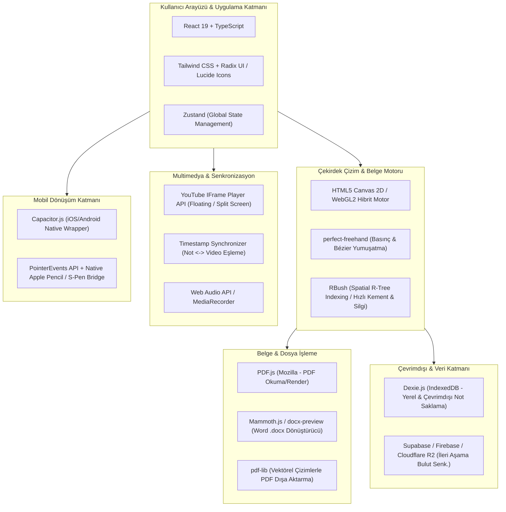

# 📓 NotFree: Kapsamlı Dijital Defter & Not Alma Platformu
## Web'den Mobile Mimari Tasarım ve Aşamalı Yol Haritası (Roadmap)

---

## 📌 1. Vizyon ve Temel Değer Önerisi (Value Proposition)

GoodNotes, Notability ve FreeNotes gibi sektör lideri uygulamalar yüksek akıcılık, üstün kalem hissiyatı ve güçlü PDF yönetimi ile öne çıkmaktadır. **NotFree** projesi, bu özellikleri bir adım öteye taşıyarak:
1. **Platform Bağımsızlığı**: İlk aşamada güçlü bir Web Uygulaması (PWA), ardından tablet odaklı Mobil Uygulama (iPadOS / Android).
2. **Akıllı Çoklu Görev (Multi-tasking)**: Not alırken eşzamanlı YouTube video oynatma, videonun ilgili anlarına zaman damgalı not bağlama (Notability'nin ses senkronizasyonunun video versiyonu) ve tek tıkla video karesi yakalayıp sayfaya yapıştırma.
3. **Ofis ve Doküman Uyumluluğu**: Hem PDF hem de Microsoft Word (.docx) belgelerini defter sayfalarına dönüştürerek doğrudan üzerine çizim ve not alma imkanı.
4. **Çok Çeşitli Şablon Kütüphanesi**: Çizgili, kareli, noktalı, Cornell, dijital ajanda, müzik portesi ve özel tasarım defterler.

---

## 🛠️ 2. Teknoloji Yığını (Tech Stack) Mimarisi

Bir not alma uygulamasında en kritik faktör **çizim gecikmesi (latency < 16ms / 60-120 FPS)** ve **vektörel çizgi kalitesidir**. Web ortamında başlayıp mobile pürüzsüz taşınabilecek en ideal mimari:

---

## 🎨 3. Defter Çeşitleri ve Sayfa Şablon Sistemi

Kullanıcılar defter oluştururken kapak ve sayfa şablonunu seçebilmeli, sayfalar arasında farklı şablonlar kullanabilmelidir:

* **Standart Notluk**: Çizgili (dar, geniş), Kareli (5mm, 7mm), Noktalı (bullet journal), Düz Beyaz
* **Akademik & Cornell**: Cornell metodu (özet, ipuçları ve ana not alanı ayrılmış), İki sütunlu çalışma kağıdı
* **Planlayıcı & Ajanda**: Yıllık, aylık, haftalık ve günlük zaman bloklu planlayıcılar, To-Do listeleri
* **Mühendislik & Çizim**: İzometrik ızgara, Milimetrik kağıt, Hexagonal (Organik kimya formülleri için)
* **Müzik & Sanat**: Müzik portesi (dizek), Kaligrafi kılavuz çizgileri, Storyboard paneli
* **Özel Kağıt Dokuları**: Beyaz, Fildişi/Krem, Sarı bloknot, Kraft, Koyu Mod (Siyah / Koyu Gri)

---

## ✒️ 4. Kalem ve Çizim Araç Seti (Inking Engine)

1. **Kalem Türleri**:
   - **Tükenmez Kalem (Ballpoint)**: Sabit genişlik, yüksek akıcılık.
   - **Dolma Kalem (Fountain Pen)**: Basınç ve çizim hızına duyarlı dinamik uç genişliği.
   - **Fırça & Kaligrafi (Brush Pen)**: Dinamik açı ve basınca göre kalınlaşan sanatsal hatlar.
   - **Fosforlu Kalem (Highlighter)**: `multiply` harmanlama modu ile arkadaki yazıyı ve PDF metnini örtmeyen yarı saydam vurgulayıcı.
2. **Düzenleme Araçları**:
   - **Hassas Piksel Silgisi & Vektörel Çizgi Silgisi** (tek dokunuşta tüm çizgiyi kaldırma).
   - **Kement (Lasso) Aracı**: Seçilen çizgileri taşıma, yeniden boyutlandırma, döndürme ve renk değiştirme.
   - **Otomatik Şekil Tanıma (Auto-shapes)**: Çizim bittiğinde kalemi 0.5 sn basılı tutunca düz çizgi, çember, elips, üçgen, dikdörtgen veya oka dönüştürme.
   - **Cetvel Aracı**: Açı ve piksel ölçekli interaktif cetvel.

---

## 📄 5. PDF ve Word (.docx) Entegrasyonu

* **PDF Açma & Not Alma**: PDF.js ile sayfaları vektörel arka plan katmanı olarak yükleme. Üzerine serbest el yazısı yazma ve fosforlu kalemle çizim yapma.
* **Word (.docx) Entegrasyonu**: Mammoth.js / docx-preview ile Word belgelerini sayfalandırılmış sayfalara dönüştürme ve el yazısıyla annotasyon ekleme.
* **Vektörel PDF Olarak Dışa Aktarma**: Orijinal PDF + kullanıcının çizim katmanını `pdf-lib` ile birleştirerek yüksek çözünürlüklü çıktı alma.

---

## 📺 6. YouTube ile Eşzamanlı Not Alma & Video-Not Senkronizasyonu

* **Bölünmüş Ekran (Split-View) & Kayar Pencere (PiP)**: Defter ekranının yanında veya köşesinde YouTube video paneli.
* **Zaman Damgalı Not Ekleme (Timestamp Sync)**: Not alırken video süresini (örn. `[▶ 14:32]`) sayfaya etiketleme. Bu rozete tıklandığında videonun doğrudan ilgili saniyeye sarılması.
* **Video Karesi Yakalama (Snapshot to Canvas)**: Videodaki grafiği veya slaytı tek tıkla ekran görüntüsü alıp deftere resim olarak yapıştırma.

---

## 🗺️ 7. Aşama Aşama Geliştirme Yol Haritası (Phased Roadmap)

| Faz | Kapsam | Süreç & Çıktılar |
| :--- | :--- | :--- |
| **Faz 1: Çekirdek & MVP** | Çizim Motoru & Temel Arayüz | React 19 + TypeScript + Canvas/perfect-freehand, temel kalemler, silgi, çizgili/kareli/cornell şablonları, çoklu sayfa yönetimi. |
| **Faz 2: Doküman Entegrasyonu** | PDF & Word Desteği + Kement | PDF.js ile PDF içe aktarma, Word (.docx) okuma, Kement (Lasso) seçimi, otomatik şekil tamamlama, PDF dışa aktarma. |
| **Faz 3: Multimedya & YouTube** | Eşzamanlı Video Not Alma | YouTube API entegrasyonu, zaman damgalı not bağlama, video karesi yakalama, ses kaydı ve senkronizasyon. |
| **Faz 4: Çevrimdışı Web & PWA** | IndexedDB & Web Yayını | Dexie.js ile offline-first depolama, PWA manifestosu, tarayıcıda masaüstü/tablet kurulum desteği, web üzerinde canlıya çıkış. |
| **Faz 5: Mobil Dönüşüm** | Capacitor ile iPadOS & Android | Capacitor sarmalayıcısı, Apple Pencil & S-Pen gecikme optimizasyonları, palm rejection (avuç içi reddetme), App Store & Google Play yayını. |
